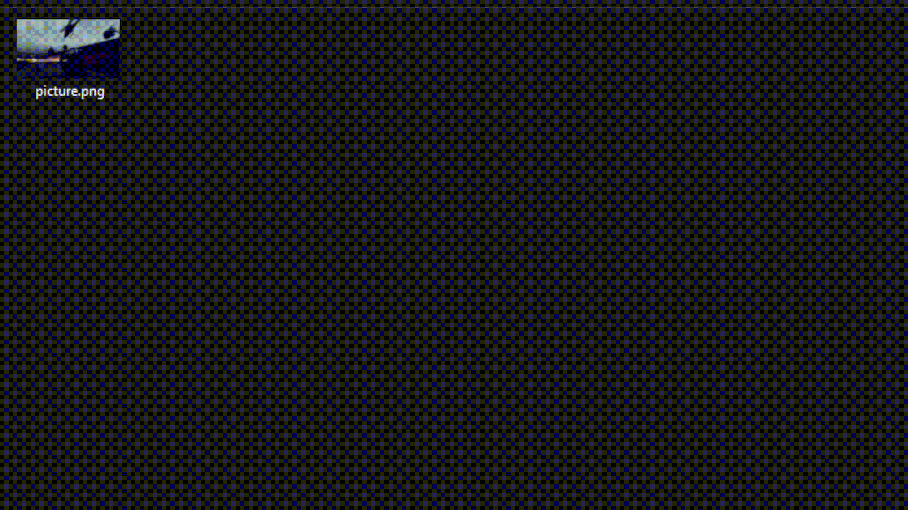
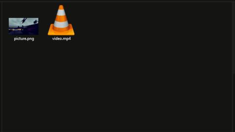
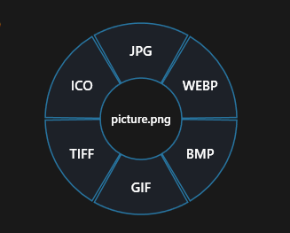

<p align="center">
  
</p>

<h1 align="center">RingTool</h1>

<p align="center">
  Convert files by dragging them onto a radial menu.<br>
  Drag a file, hold <b>Alt</b>, release it on the format you want. Done.
</p>

<p align="center">
  
</p>

---

## What is it?

RingTool is a small Windows tray app written in Rust. It works anywhere you can drag a file: Explorer, the Desktop, and so on.

1. **Drag** a file (or a link from your browser) with the mouse.
2. **Hold Alt.** A ring appears around your cursor.
3. **Move** to a segment. Some rings have a second level with more options.
4. **Release** on the format you want. The conversion runs in the background.

Converted files are new copies saved next to the original, and existing files are never overwritten. If the name is taken, `_1`, `_2` and so on is added. Releasing outside the ring does nothing.

<p align="center">
  
  &nbsp;
  
</p>

## Features

- **Smart ring:** it reads what you are dragging, so you only see options that make sense for it.
- **Convert across types:** video to audio, video to a still frame, and more.
- **Image + audio to video:** drag one image and one audio file together to make a video with a still picture (MP4, MKV or MOV).
- **Download links:** drag a link onto the ring and download it as video or audio with yt-dlp.
- **3D models:** convert between model formats through Blender.
- **Notifications:** Windows notifications when a conversion starts, finishes or fails.
- **Settings window:** tool paths, which formats appear on the ring, and quality settings.
- **No console window** in release builds, and the exe carries the RingTool icon.

## Supported conversions

| You drag...          | Options |
|----------------------|---------|
| **Image**            | PNG, JPG, WEBP, BMP, GIF, TIFF, ICO |
| **Audio**            | MP3, WAV, FLAC, AAC, OGG, OPUS, M4A |
| **Video**            | *Images:* first frame as PNG, JPG, WEBP, BMP, GIF, TIFF or ICO<br>*Audio:* extract to any audio format<br>*Video:* MP4, MKV, WEBM, MOV, AVI, GIF |
| **Image + audio**    | MP4, MKV, MOV (still image with the audio) |
| **3D model**         | GLB, GLTF, FBX, OBJ, STL, DAE, PLY (needs Blender) |
| **Link**             | *Video:* MP4, MKV, WEBM<br>*Audio:* MP3, M4A, OPUS, WAV, FLAC |

The file's own format is hidden, so an MP4 never offers "MP4". 3MF appears on the ring for models but is not supported, because Blender has no built-in importer for it.

Dragged links are downloaded with yt-dlp, so they work for the sites it supports. Spotify is not one of them, because its audio is DRM-protected.

<p align="center">
  
</p>

## Requirements

- Windows 10 or 11 (64-bit)
- [FFmpeg](https://ffmpeg.org/) for images, audio and video
- [yt-dlp](https://github.com/yt-dlp/yt-dlp) for link downloads (optional)
- [Blender](https://www.blender.org/) 4.0 or newer for 3D models (optional)

RingTool does not bundle or download these tools. Set their locations in **Settings** (see below).

## Settings

Right-click the tray icon and choose **Settings**.

- **General:**
  - Browse to `ffmpeg.exe`, `blender.exe` and `yt-dlp.exe`. Each row shows whether the file was found.
  - Choose whether downloaded links are saved to the folder of your frontmost Explorer window or to your Downloads folder.
- **Formats:** click a format to hide it from the ring or show it again.
- **Quality:**

| Setting | Range | Applies to |
|---------|-------|------------|
| Audio bitrate | 64 to 320 kbps | MP3, AAC, OGG, OPUS, M4A |
| Video quality | CRF 16 to 32 (lower is better) | MP4, MKV, MOV, WEBM |
| Image quality | 50 to 100% | JPG, WEBP |
| ICO size | 16 to 256 px | ICO |

Settings are saved automatically to `%APPDATA%\RingTool\settings.ini`.

The default tool paths are set in `src/main.rs` (`FFMPEG_PATH`, `BLENDER_PATH`, `YTDLP_PATH`) and currently point to the author's machine. Change them in Settings, or edit those constants before building.

## Building from source

You need the [Rust toolchain](https://rustup.rs/) with the MSVC target on Windows.

```bash
git clone https://github.com/antalervin19/RingTool.git
cd RingTool
cargo run
```

Build the release exe (no console window, icon embedded):

```bash
cargo build --release
```

The result is `target\release\RingTool.exe`. Pushing a tag such as `v0.1.0` runs the GitHub Action in `.github/workflows/release.yml`, which builds it and attaches `RingTool-win-x64.zip` to a release.

## Project layout

| File | What it does |
|------|--------------|
| `src/main.rs` | Entry point, tray icon and menu, default tool paths |
| `src/platform/windows.rs` | Mouse and keyboard hooks, the ring window, the drop target (files and links), notifications |
| `src/platform/settings_window.rs` | The settings window |
| `src/common/menu.rs` | Which ring to show for a file, link or file pair |
| `src/common/render.rs` | Drawing the ring and text |
| `src/common/ring.rs` | Ring geometry and hit testing |
| `src/common/convert.rs` | FFmpeg, Blender and yt-dlp commands |
| `src/common/settings.rs` | Settings storage and defaults |
| `build.rs` | Embeds `icon.ico` into the exe |

## Contributing

Contributions are welcome, whether it's a bug report, a new format, or a whole feature.

**Reporting a bug**
- Open an [issue](https://github.com/antalervin19/RingTool/issues) with your Windows version, what you dragged (file type), what you expected, and what happened.
- A short screen recording or GIF helps a lot.

**Sending code**
1. Fork the repo and create a branch: `git checkout -b feature/my-idea`
2. Make your change and test it with `cargo run`.
3. Keep changes focused. One feature or fix per pull request.
4. Open a pull request and describe what it does and how you tested it.

**Easy first contribution: add a format.** Add it to the format lists in `src/common/menu.rs` and `FORMAT_GROUPS` in `src/common/settings.rs`, then handle any special FFmpeg arguments in `src/common/convert.rs`.

## Credits and licenses

- Conversions are powered by [FFmpeg](https://ffmpeg.org/), [Blender](https://www.blender.org/) and [yt-dlp](https://github.com/yt-dlp/yt-dlp), which you install yourself. Each has its own license.
- RingTool is released under [Creative Commons Attribution-NonCommercial-ShareAlike 4.0](LICENSE.md).

---

<p align="center">Made with a cursor and too many file formats.</p>